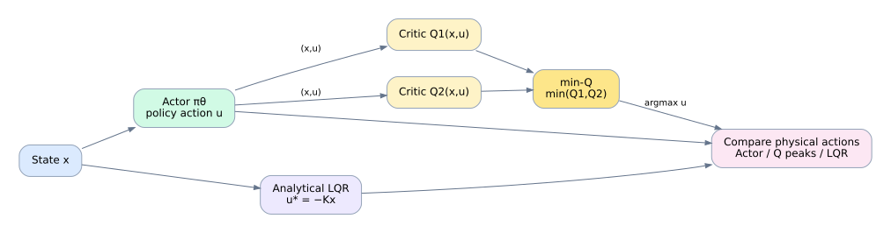
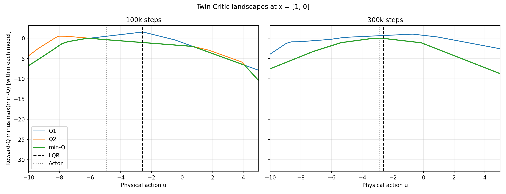
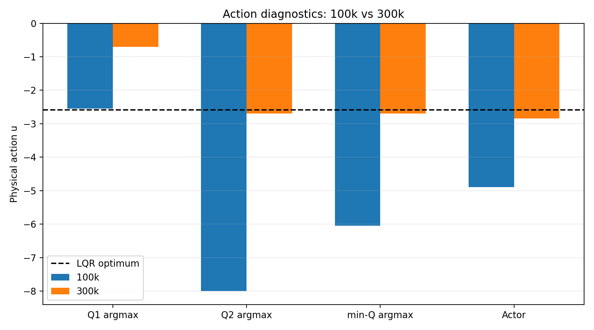

# 解析的LQRを基準としたSACの学習診断 — ActorとTwin Criticの比較

## 1. 背景と目的

線形二次レギュレータ（LQR）では、モデルと二次形式の評価関数が与えられれば、Riccati方程式から最適な状態フィードバックを計算できる。一方、強化学習では、最適制御則をあらかじめ与えず、環境との相互作用から方策を学習する。

そこで本実験では、**解析的な最適入力が既知のLQR問題をSoft Actor-Critic（SAC）で学習させたとき、SACの入力はその基準にどこまで近づくのか**を調べた。

SACの学習を進め、環境との相互作用が10万ステップに達した時点（100k）と30万ステップに達した時点（300k）でモデルを保存した。100kではSACの入力はLQR基準から大きくずれていた。
しかし、300kステップまで学習すると、その差は大幅に小さくなった。この変化を理解するため、最終的なActorの出力だけでなく、SACが内部で学習する2つのCritic（Twin Critic）と、その点ごとの最小値（min-Q）も比較した。

本記事の問いは次の2つである。

1. SACの決定論的Actorは、学習の進行に伴って解析的LQR入力に近づくか。
2. Actorの変化は、2つのCriticおよびmin-Qの形状とどのような関係にあるか。

これは、SACがLQRと数学的に同一の最適化問題を解いていることや、一般的な収束性を証明する研究ではない。**正解を計算できる制御問題を使い、学習済み方策と価値推定器の挙動を観察するケーススタディ**である。

## 2. 制御問題とLQRの解析解

対象は次の2状態・1入力の離散時間線形系とする。状態は $x_k\in\mathbb{R}^2$、制御入力は $u_k\in\mathbb{R}$ である。

$$
x_{k+1}=Ax_k+Bu_k,\qquad
A=\begin{bmatrix}1&0.1\\0&1\end{bmatrix},\qquad
B=\begin{bmatrix}0\\0.1\end{bmatrix}.
$$

この $A$ は固有値1を重複して持ち、開ループでは漸近安定ではない。適切な状態フィードバックにより安定化することを考える。

ステージコストは

$$
\ell(x,u)=x^\top Qx+u^\top Ru,\qquad Q=I_2,\quad R=0.1
$$

とする。割引なし・無限時間LQRの評価関数は

$$
J(x_0)=\sum_{k=0}^{\infty}\ell(x_k,u_k)
$$

であり、離散時間代数Riccati方程式の安定化解 $P$ から

$$
K=(R+B^\top PB)^{-1}B^\top PA,\qquad u_{\mathrm{LQR}}(x)=-Kx
$$

を得る。本実験では入力を比較する状態を **$x_{\mathrm{test}}=[1,0]^\top$** に固定した。このときの解析的LQR入力は

$$
u_{\mathrm{LQR}}(x_{\mathrm{test}})\simeq -2.5853
$$

となる。**本実験では、この値をSACのActor出力およびCriticから求めた入力の比較基準とする。**

参考として、LQRの最適*コスト*行動価値関数は

$$
Q^*_{\mathrm{LQR,cost}}(x,u)
=\ell(x,u)+(Ax+Bu)^\top P(Ax+Bu)
$$

と書ける。この関数は**最小化**する。一方、以下で扱うSACのCriticは*報酬*に対するQ値であり、一般に**最大化**する方向が望ましい。両者のQ値を同じ数値として比較するのではなく、ここでは主として**選択される物理入力 $u$** を比較する。

## 3. SACの概要

SAC（Soft Actor-Critic）は、方策を学習するActorと、状態・行動の価値を推定するCriticを用いる強化学習アルゴリズムである。

- **Actor** $\pi_\theta(u\mid x)$：状態 $x$ に対する行動の分布を表す。今回の比較では、学習済みActorから決定論的な入力を取得する。
- **Critic** $Q_{\phi_i}(x,u)$：状態 $x$ で入力 $u$ を選んだ場合の将来報酬を推定する。
- **Twin Critic**：標準的なSACでは2つのCritic $Q_1,Q_2$ を学習し、更新時に小さい方の推定値を用いて過大評価を抑える。2つのCriticを使うのは今回独自の設定ではない。

本記事では、2つのCriticの点ごとの最小値を

$$
Q_{\min}(x,u)=\min\{Q_1(x,u),Q_2(x,u)\}
$$

と表記する。Criticを3個以上用いるアンサンブル型の手法もあるが、本実験の対象は標準的な2-Critic構成である。

なお、**Actorの出力は単純に $\arg\max_u Q_{\min}(x,u)$ を計算した結果ではない**。SACはエントロピー正則化を含む目的に基づき、パラメータ化された方策を更新する。このため、Actorの出力とmin-Qの最大点は一致しなくてもよい。

以下の図は、本記事で比較する各要素の関係を模式的に示す。Actorは状態から入力を生成し、2つのCriticは状態と入力からそれぞれQ値を推定する。min-Qはその2つの小さい方を選んだ値である。**LQRはSACの学習には使用せず、比較のために別途解析的に求める。** 図の矢印は主要な情報の流れを示すもので、SACの全更新式を表したものではない。



学習にはStable-Baselines3（SB3）のSACを使用した。方策・価値関数の近似にはMLP（Multi-Layer Perceptron：全結合層を重ねたニューラルネットワーク）を用いる。

## 4. 実験条件と診断方法

### 4.1 学習条件

| 項目 | 設定 |
|---|---|
| アルゴリズム | SB3 SAC |
| ネットワーク | 2層MLP、各層64ユニット |
| 学習率 | $10^{-4}$ |
| Replay Buffer容量 | 100,000 |
| 学習開始 | 5,000ステップ |
| バッチサイズ | 256 |
| 割引率 $\gamma$ | 0.99 |
| ターゲット更新係数 $\tau$ | 0.005 |
| エントロピー係数 | 自動調整 |
| 物理入力の範囲 | $[-10,10]$ |
| 初期状態 | $[-2,2]^2$ の一様分布 |
| エピソード終了 | 200ステップで打ち切り、または状態ノルムが10を超えたとき |
| 乱数シード | 0 |

同じ学習実行の途中で**100kステップ**と**300kステップ**のモデルを保存し、比較した。したがって、ここで示す2つの結果は、別々に学習したモデルの比較ではなく、**同一学習系列の途中経過**である。

### 4.2 なぜCriticを診断するのか

ActorがLQR基準からずれていた場合、Actorの出力だけを見ても、学習内部で何が起きているかは分からない。そこで、評価状態 $x_{\mathrm{test}}=[1,0]^\top$ を固定し、入力 $u$ だけを $-10$ から $10$ まで401点変化させて、$Q_1(x_{\mathrm{test}},u)$、$Q_2(x_{\mathrm{test}},u)$、$Q_{\min}(x_{\mathrm{test}},u)$ を調べた。

状態を固定するのは、**同じ状態でどの入力が高く評価されるか**を1次元の曲線として可視化するためである。各曲線の最大点、Actorの入力、LQRの入力を並べることで、学習の進行に伴う変化を比較できる。

SB3のCriticに入力する際は、物理入力 $[-10,10]$ をネットワークが想定する正規化入力へ変換している。実装は `scripts/compare_twin_critics.py` を参照されたい。

## 5. 結果と考察

### 5.1 100kでは大きな誤差があり、300kではLQRに接近した

| 診断指標（物理入力 $u$） | 100k | 300k |
|---|---:|---:|
| 解析的LQR入力 | -2.585 | -2.585 |
| $\arg\max_u Q_1(x_{\mathrm{test}},u)$ | -2.550 | -0.700 |
| $\arg\max_u Q_2(x_{\mathrm{test}},u)$ | -8.000 | -2.700 |
| $\arg\max_u Q_{\min}(x_{\mathrm{test}},u)$ | -6.050 | -2.700 |
| 決定論的SAC Actor | -4.897 | -2.842 |
| ActorとLQRの入力絶対誤差 | 2.312 | 0.257 |
| min-Q最大点とLQRの入力絶対誤差 | 3.465 | 0.115 |

まず注目すべきは**Actorの行**である。100kではLQR入力 $-2.585$ に対してActorは $-4.897$ と大きくずれている。一方、300kでは $-2.842$ となり、絶対誤差は **2.312から0.257へ約89%減少**した。少なくともこの評価状態では、学習を進めることでActorがLQR基準に大きく近づいた。

次に**Criticの最大点**を見る。100kでは $Q_1$ の最大点だけがLQRに近く、$Q_2$ とmin-Qの最大点は大きくずれている。300kでは $Q_2$ とmin-Qの最大点がLQRに接近した一方、$Q_1$ 単体の最大点はむしろ遠ざかった。

### 5.2 Twin Critic曲線の読み方



Criticの推定Q値 $Q_i(x,u)$ は、状態 $x$ で入力 $u$ を選び、その後は学習中の方策に従ったときに得られる**将来の割引報酬（SACではエントロピー項も考慮する）の価値を、ニューラルネットワークで近似した値**である。これは解析的に計算したLQRのコストQ関数とは異なる。学習済みのCriticを固定すれば、状態と入力を指定したときの推定値は一意に定まる。

図の**横軸は物理入力 $u$**、**縦軸は各Criticの推定Q値から表示用の定数 $c$ を引いた値**である。各チェックポイントについて、入力グリッド上で

$$
c=\max_{u\in\mathcal U_{\mathrm{grid}}} Q_{\min}(x_{\mathrm{test}},u),\qquad
\widetilde Q_i(x_{\mathrm{test}},u)=Q_i(x_{\mathrm{test}},u)-c
$$

と定め、$Q_1$、$Q_2$、$Q_{\min}$ の3本すべてから同じ $c$ を引いている。つまり、**min-Q曲線の最高点が縦軸の0になるようにグラフを上下に動かしただけ**であり、Criticの推定値や最大点の入力を変更したわけではない。100kと300kではそれぞれ異なる $c$ を使うため、両図の縦軸からQ値の絶対水準を直接比較することはできない。

図では3本の曲線と、LQR入力・Actor入力を示す縦線を比較する。

- **100k（左）**：$Q_1$ の山の頂点はLQR付近にあるが、$Q_2$ の最大点は左に大きくずれる。その結果、2つの小さい方を取ったmin-Qの最大点もLQRから離れている。
- **300k（右）**：$Q_2$ とmin-Qの最大点がLQR付近に移動し、Actorの縦線もLQRの縦線に近づく。ただし、$Q_1$ の最大点はLQRから離れている。


### 5.3 入力比較の読み方



こちらは各チェックポイントの**入力の位置だけ**を比較した図である。**LQR入力を示す黒破線に近いほど、今回定義した入力誤差は小さい**（ただしSAC自身の目的関数に関する最適性を意味するものではない）。100kではActorとmin-Qの最大点がLQRから離れているが、300kでは両方ともLQR付近に集まることが分かる。

興味深いのは、**$Q_1$ 単体の最大点がLQRから遠ざかっても、Actorの入力誤差は小さくなっている**ことである。これは「個々のCriticの最大点がすべて正解に近づくこと」と「ActorがLQR基準に近づくこと」が同義ではない、という観測結果である。

ただし、**min-QがActor改善の原因だと断定はできない**。Actorはmin-Qの単純な最大化ではなく、エントロピー正則化された方策学習によって更新される。本実験が示すのは、同じ学習系列でActorと各Criticの入力選好がどのように変化したかという観測事実であり、Actorの改善がどの更新要素によって生じたかの切り分けまでは行っていない。

## 6. 再現方法

このリポジトリには、学習用スクリプトと、保存済みモデルから診断図を生成するスクリプトを分けて用意する。

Python環境にNumPy、SciPy、Gymnasium、Stable-Baselines3、PyTorch、Matplotlibを導入する。依存関係の詳細は `requirements.txt` を参照する。

リポジトリのルートで、まず学習を実行する。

```bash
python scripts/train_sac_lqr.py
```

これにより、同じ学習実行から `models/sac_lqr_trained_100k.zip` と `models/sac_lqr_trained_300k.zip` を保存する。すでに同名のモデルが存在する場合は、誤上書きを避けるため、実行前に保存先を確認する。**保存済みモデルがある場合は、学習を省略できる。**

次に診断を実行する。

```bash
python scripts/compare_twin_critics.py
```

生成されるファイルは以下の3つである。

- `figures/twin_critic_100k_vs_300k.png`
- `figures/action_comparison.png`
- `figures/action_summary.csv`

学習環境やライブラリのバージョンによって、再学習したモデルの数値が掲載結果と完全一致するとは限らない。掲載図と同じチェックポイントを評価する場合は、そのチェックポイントのモデルファイルを使用する必要がある。

## 7. 結論

解析的なLQR入力が既知の線形二次制御問題を用い、SACの学習途中のActorとTwin Criticを診断した。

**本実験で確認できたこと**は、固定状態 $x=[1,0]^\top$ において、100kではLQR入力から大きくずれていたActorが、300kでは大幅に近づいたことである。また、2つのCriticの最大点は一様にはLQRへ近づかず、min-QやActorとは異なる変化を示した。

このことから、SACの学習状態を理解する際には、最終的なActor出力だけでなく、**個々のCriticとmin-Qを併せて可視化することが有用**だと分かった。ただし、この比較から「min-Qの変化がActorの改善を引き起こした」とまでは結論づけられず、SACの一般的な収束性を示すものでもない。

### 比較の位置づけと限界

LQRは割引なしの無限時間コストを最小化するのに対し、今回のSACは割引率 $\gamma=0.99$、エントロピー正則化、エピソード境界を持つ報酬最大化問題を扱う。したがって、**SACのQ値がLQRの最適コストQ関数に一致することは要求していない**。ここで評価しているのは、同じ制御対象に対する**Actorの物理入力が、既知のLQR入力にどれだけ近いか**である。この意味で比較は有用だが、入力が近いことだけでSACの目的関数上の最適性を保証するものではない。

また、結果は単一状態・単一シードのケーススタディであり、状態空間全体での入力誤差、閉ループ安定性、制御性能を結論づけるものではない。

## 8. Future Work

今回の固定状態での診断を出発点として、状態空間上でのActorとCriticの入力選好の違い、複数シードでの再現性、閉ループコストや安定性との関係を調べることが考えられる。これにより、**入力が解析的基準に近いことと、実際の制御性能が良いことの関係**をより体系的に評価できる。

さらに、モデルベースの最適制御と学習ベース制御の比較・統合へ発展させたい。例えば、LQR・MPC・iLQRの比較を通じて制約付き制御へ対象を広げることや、Residual RLとLyapunov条件を組み合わせ、**学習による性能向上と制御理論に基づく安定性の両立**を探ることが次の方向性である。
